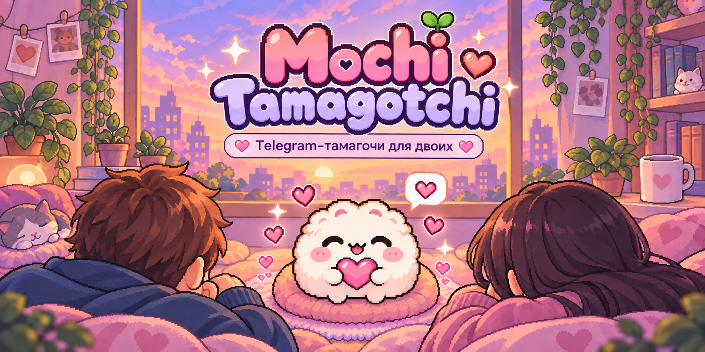

<p align="center">
  
</p>

<h1 align="center">🐱 Mochi Tamagotchi</h1>

<p align="center">
  <b>Telegram-тамагочи для двоих — растите общего Mochi, заботьтесь о нём и играйте вместе</b>
</p>

<p align="center">
  
  
  
  
  
</p>

<p align="center">
  <a href="#-идея">Идея</a> •
  <a href="#-что-внутри">Что внутри</a> •
  <a href="#-как-играется">Как играется</a> •
  <a href="#-быстрый-запуск">Запуск</a> •
  <a href="#-структура">Структура</a> •
  <a href="#-roadmap">Roadmap</a>
</p>

<p align="center">
  <i>Один питомец на двоих, немного заботы, немного хаоса и много уютных игровых моментов 💗</i>
</p>

---

## 💡 Идея

**Mochi Tamagotchi** — это Telegram-бот, в котором два человека вместе растят одного питомца.

Проект задумывался как маленькая кооперативная игра: один человек может зайти утром, покормить Mochi и проверить состояние комнаты, а второй — вечером поиграть с ним, забрать награды или купить что-нибудь в магазин. В итоге получается не просто бот с командами, а общий маленький мир внутри Telegram.

Мне хотелось сделать штуку, в которую приятно играть **вдвоём** — парам, друзьям или любым близким людям, которым нравится идея совместной заботы о виртуальном питомце.

## ✨ Что внутри

- 🐾 **Общий питомец для двоих** — один Mochi на двух игроков.
- 🔗 **Инвайт второго игрока** — можно создать питомца и позвать второго человека.
- 🍓 **Параметры питомца** — голод, счастье, энергия и другие игровые состояния.
- 📈 **Прогресс** — уровни, XP и постепенное развитие Mochi.
- 🪙 **Внутренняя экономика** — монеты, награды и покупки.
- 🎁 **Ежедневки** — регулярные бонусы за возвращение в игру.
- 🏆 **Ачивки** — достижения за действия и прогресс.
- 🛒 **Магазин** — покупка предметов и улучшений.
- 🏠 **Комната питомца** — кастомизация и визуальные изменения.
- 💌 **Mochi Mail** — игровые письма, события и мелкие приятности.
- 🤝 **Совместные действия** — игра именно про взаимодействие двух людей.
- 🐱 **Несколько Mochi** — можно играть не только с одним человеком.

## 🎮 Как играется

Типичный цикл выглядит так:

1. создаёшь Mochi;
2. приглашаешь второго игрока;
3. вместе следите за состоянием питомца;
4. кормите, играете, отдыхаете и копите прогресс;
5. открываете предметы, награды и достижения;
6. украшаете комнату и постепенно развиваете своего Mochi.

Именно за счёт совместной игры бот и ощущается живым: кто-то заходит чаще, кто-то реже, но питомец — один на двоих.

## 🧠 Почему проект цепляет

Это не просто “ещё один Telegram-бот”, а маленькая кооперативная игра внутри привычного мессенджера.

- не нужно ставить отдельное приложение;
- легко начать;
- есть чувство общего прогресса;
- игра хорошо подходит и для пар, и для друзей;
- у проекта уютный вайб, а не только механика ради механики.

## 🛠️ Стек

`Python` · `aiogram` · `aiosqlite` · `python-dotenv` · `Pillow` · `imageio-ffmpeg` · `Telegram Bot API`

## 🚀 Быстрый запуск

### 1) Клонируй репозиторий

```bash
git clone https://github.com/murzichek5-spec/mochi-tamagotchi.git
cd mochi-tamagotchi
```

### 2) Создай виртуальное окружение

**Linux / macOS**
```bash
python -m venv .venv
source .venv/bin/activate
```

**Windows**
```bash
python -m venv .venv
.\.venv\Scripts\activate
```

### 3) Установи зависимости

```bash
pip install -r requirements.txt
```

### 4) Создай `.env`

Скопируй шаблон:

```bash
cp .env.example .env
```

И заполни переменные:

```env
BOT_TOKEN=your_telegram_bot_token
BOT_USERNAME=your_bot_username_without_at
ADMIN_IDS=123456789
```

### 5) Запусти бота

```bash
python bot.py
```

## ⚙️ Конфиг

Сейчас бот использует три основные переменные окружения:

- `BOT_TOKEN` — токен Telegram-бота;
- `BOT_USERNAME` — username бота без `@`;
- `ADMIN_IDS` — список Telegram ID администраторов через запятую.

## 📁 Структура

```text
mochi-tamagotchi/
├── .github/
│   ├── ISSUE_TEMPLATE/
│   └── pull_request_template.md
├── assets/
│   └── banner.png
├── .env.example
├── .gitignore
├── README.md
├── SECURITY.md
├── bot.py              # основной файл бота
├── config.py           # загрузка и валидация переменных окружения
├── db.py               # база данных, состояние игры, прогресс, ачивки
├── keyboards.py        # inline-клавиатуры и навигация
├── room_renderer.py    # рендер комнаты / визуального состояния
├── requirements.txt
└── ...
```

## 🖼️ Что можно улучшить дальше

- GIF/скриншоты игрового процесса прямо в README;
- отдельный раздел со всеми игровыми механиками;
- список доступных предметов и ачивок;
- demo-видео;
- Docker / Docker Compose;
- CI и тесты.

## 🗺 Roadmap

- [ ] Docker / Docker Compose
- [ ] больше предметов для комнаты
- [ ] больше совместных механик
- [ ] сезонные ивенты
- [ ] экспорт / импорт прогресса
- [ ] тесты и CI

## 🔐 Безопасность

Не загружай в GitHub:

```text
.env
*.db
__pycache__/
*.pyc
```

Если токен уже попал в историю Git — его надо перевыпустить.

Подробнее см. в `SECURITY.md`.

---

<p align="center">
  <b>💗 Этот бот про совместную игру, заботу и маленькие общие моменты.</b>
</p>
